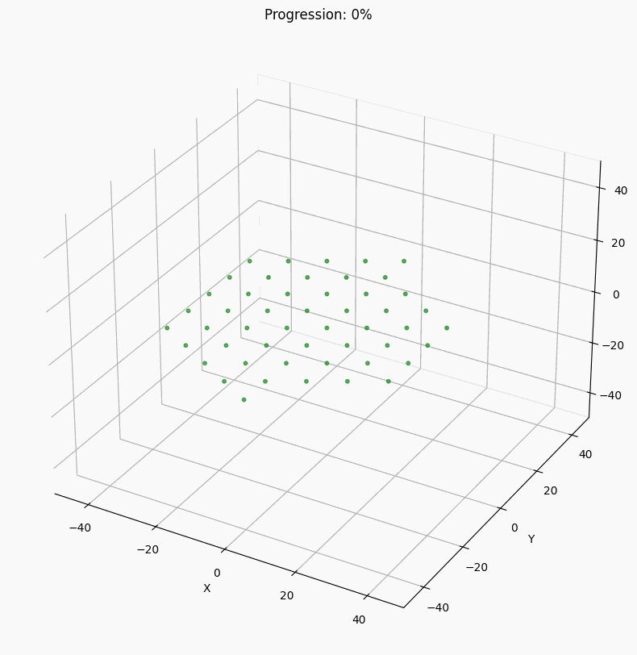

# Drone swarm simulation

A 3D simulation of a drone swarm in Python. Drones are placed in a hexagonal formation, moved as a
group through translations and rotations, and the result is rendered as an animated GIF.

Started as a project for the ECAM computer science society. The simulation stage is what this
repository covers; flying the formation on real hardware is the next step and is not implemented
here.



## Formation

`CreateDrone.Répartition(n, spacing)` places `n` drones in concentric hexagonal rings around a
centre point. It starts with the centre drone, then for each ring walks the six vertices and fills
the segments between them, stopping as soon as the requested count is reached. The result is a
dense, evenly spaced layout that stays compact as the swarm grows — there is no fixed grid size to
pick in advance.

## Movement

`Deplacement.py` holds the geometric primitives, each applied to the whole set of coordinates:

- `X`, `Y`, `Z` :translation along one axis
- `rotX`, `rotY`, `rotZ` :rotation around one axis, by direct application of the rotation matrix

`DéplacementVectoriel.py` builds on these to move the swarm along a vector rather than axis by
axis.

Movements are composed by chaining calls, so a trajectory is a sequence of transformations applied
to the formation as a rigid body. Individual drone autonomy and collision avoidance are out of
scope.

## Rendering

`Animation.py` interpolates between two positions, draws each intermediate step with matplotlib's
3D axes, and writes the frames as numbered PNGs. The frames are then assembled into a GIF with
Pillow.

`Main.py` ties it together: it sets the swarm size and the bounds of the flight volume, asks for
the movements to apply, and produces the animation. The defaults are 50 drones in a 100×100×100
volume, with 50 interpolated frames between each pair of positions.

## Running it

```bash
pip install numpy matplotlib pillow
python Main.py
```

The script prompts for the movements to apply, then writes the frames and the final GIF to the
working directory. Frame count scales with the number of movements, so long sequences take a
while — most of the runtime is matplotlib redrawing the 3D scene, not the geometry.

## Files

| File | Role |
| --- | --- |
| `Main.py` | Entry point, parameters, animation loop |
| `CreateDrone.py` | Hexagonal placement of the swarm |
| `Deplacement.py` | Translations and rotations |
| `DéplacementVectoriel.py` | Movement along an arbitrary vector |
| `Animation.py` | Frame rendering and GIF assembly |
